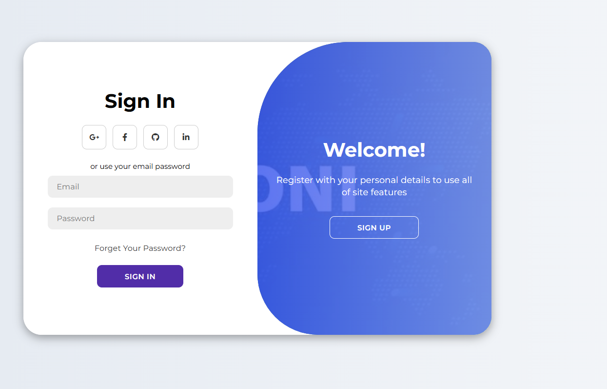

# 🏠 Smart Comfort Room

Système IoT de surveillance et de contrôle du confort d'une salle : mesures en temps réel, gestion des accès par RFID, réservations et alertes.

Projet d'équipe réalisé dans le cadre du PFA à l'ISSAT Kairouan (Licence en Ingénierie des Systèmes Informatiques, spécialité Systèmes Embarqués et IoT) et d'un stage chez LEONI.

🔗 **Démo en ligne :** https://smart-room-c163c.web.app


## ✨ Fonctionnalités

- Mesure en temps réel de la température, de l'humidité, de la qualité de l'air et de la luminosité
- Détection de présence
- Contrôle d'accès par badge RFID
- Gestion des réservations de la salle
- Alertes automatiques selon des seuils saisonniers (ASHRAE 55/62.1, EN 12464-1)
- Dashboard web avec jauges et actionneurs

## 🧰 Technologies

| Partie | Outils |
|---|---|
| Microcontrôleur | ESP32 |
| Capteurs | DHT22, MQ-135, PIR, LDR, RFID RC522 |
| Base de données | Firebase Firestore |
| Frontend | HTML, CSS, JavaScript (architecture MVC) |
| Hébergement | Firebase Hosting |
| Simulation | Wokwi |

## 🗂️ Structure du projet

```
smart-room/
├── config/     # configuration Firebase
├── public/     # pages du dashboard
├── src/        # models, views, controllers (MVC)
├── firebase.json
└── firestore.rules
```

## 🗄️ Base de données (Firestore)

6 collections : `utilisateurs`, `salle`, `mesures`, `reservations`, `acces_logs`, `alertes`

## 🔒 Sécurité

Les règles Firestore n'autorisent la lecture et l'écriture qu'aux utilisateurs authentifiés.

## 🚀 Installation

1. Cloner le projet
   ```bash
   git clone https://github.com/Nourhene-lajmi/smart-room.git
   cd smart-room
   ```
2. Installer Firebase CLI
   ```bash
   npm install -g firebase-tools
   firebase login
   ```
3. Lancer en local
   ```bash
   firebase serve
   ```
